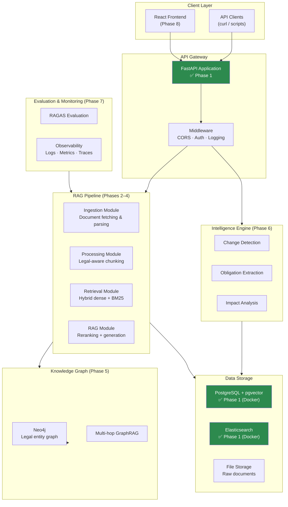

# RegulaRAG

> **AI-Powered Regulatory Intelligence & Compliance Analysis Platform**

[](https://www.python.org/)
[](https://fastapi.tiangolo.com/)
[](https://docs.astral.sh/uv/)
[](https://docs.astral.sh/ruff/)
[](#development-roadmap)
[](LICENSE)

---

## Project Overview

Regulatory compliance is one of the most research-intensive activities that organisations face today. Legal teams, compliance officers, and policy analysts must continuously track, interpret, and apply dense legislative documents — the EU AI Act alone spans over 150 articles with interconnected obligations, definitions, and recitals.

**RegulaRAG** addresses this challenge by building an AI-powered platform that combines advanced Retrieval-Augmented Generation (RAG) with a Legal Knowledge Graph, enabling organisations to:

- **Search** across multiple EU regulations simultaneously with legal-aware semantic retrieval.
- **Analyse** regulatory obligations, definitions, and cross-references.
- **Monitor** legislative changes and understand their compliance impact.
- **Generate** citation-grounded answers to specific compliance questions.

RAG is particularly well-suited to legal intelligence because it:
1. Grounds every answer in traceable source documents, reducing hallucination risk.
2. Handles the long-context, high-precision retrieval that legal text demands.
3. Enables version-aware analysis as regulations evolve over time.

> [!IMPORTANT]
> RegulaRAG is designed for **regulatory research and compliance support**. It does not constitute qualified legal advice and should not replace consultation with a qualified legal professional.

---

## Key Features

### ✅ Implemented (Phase 1 — Foundation)

| Feature | Status |
|---------|--------|
| Modular Python project architecture | ✅ |
| FastAPI application with health endpoints | ✅ |
| Pydantic Settings configuration management | ✅ |
| Structured JSON/console logging (structlog) | ✅ |
| Typed exception hierarchy | ✅ |
| PostgreSQL + pgvector Docker service | ✅ |
| Elasticsearch Docker service | ✅ |
| Multi-stage production Dockerfile | ✅ |
| pytest test suite with async support | ✅ |
| Ruff lint + format configuration | ✅ |
| Architectural Decision Records | ✅ |
| Official regulatory source registry & data contract | ✅ (Subphase 2.1) |

### 🔜 Planned (Phases 2–8)

| Feature | Phase |
|---------|-------|
| Automated regulatory document ingestion | 2 |
| Legal document structure extraction | 3 |
| Legal-aware semantic chunking | 3 |
| pgvector vector store integration | 3 |
| Hybrid RAG (dense retrieval + BM25) | 4 |
| Cross-encoder reranking | 4 |
| Citation-grounded answer generation | 4 |
| Query routing and decomposition | 4 |
| Legal Knowledge Graph (Neo4j) | 5 |
| Multi-hop GraphRAG | 5 |
| Regulatory version comparison | 6 |
| Regulatory change detection | 6 |
| Obligation extraction and impact analysis | 6 |
| RAG evaluation and benchmarking (RAGAS) | 7 |
| Monitoring and observability | 7 |
| React frontend application | 8 |
| Production deployment (Docker / Kubernetes) | 8 |

---

## Use Cases

### Regulatory Research Questions
- *"What are the high-risk AI system requirements under the EU AI Act?"*
- *"How does GDPR define a data breach and what are the notification timelines?"*
- *"What obligations does the DSA impose on very large online platforms?"*

### Cross-Regulation Analysis
- *"How do the data minimisation principles in GDPR and the Data Act compare?"*
- *"Which articles of the EU AI Act interact with NIS2 cybersecurity requirements?"*

### Change Detection & Monitoring
- *"What changed between the initial EU AI Act proposal and the adopted text?"*
- *"Which GDPR provisions were affected by the Schrems II ruling?"*

### Obligation Extraction
- *"List all Article 13 transparency obligations applicable to our AI product."*
- *"Generate a compliance checklist for launching a chatbot in the EU."*

---

## Supported Regulatory Scope

| Regulation | Full Name | Coverage |
|-----------|-----------|----------|
| **EU AI Act** | Regulation (EU) 2024/1689 on Artificial Intelligence | Planned Phase 2 |
| **GDPR** | General Data Protection Regulation (EU) 2016/679 | Planned Phase 2 |
| **DSA** | Digital Services Act (EU) 2022/2065 | Planned Phase 2 |
| **DMA** | Digital Markets Act (EU) 2022/1925 | Planned Phase 2 |
| **Data Act** | Regulation (EU) 2023/2854 | Planned Phase 2 |
| **NIS2** | Network and Information Security Directive (EU) 2022/2555 | Planned Phase 2 |

---

## System Architecture

The platform is designed as a **modular monolith** — a single deployable Python application with clearly separated internal modules. This provides simplicity and maintainability in early phases while enabling extraction into microservices as scale demands.



> **Legend:** Green nodes (✅) are implemented in Phase 1. All other nodes are planned for future phases.

---

## Technology Stack

| Category | Technology | Version | Status |
|----------|-----------|---------|--------|
| **Backend** | Python | 3.12+ | ✅ |
| **Backend** | FastAPI | 0.115+ | ✅ |
| **Backend** | Pydantic Settings | 2.6+ | ✅ |
| **Backend** | Uvicorn | 0.32+ | ✅ |
| **Backend** | structlog | 24.4+ | ✅ |
| **AI/NLP** | Sentence Transformers | 3.3+ | Planned Phase 3 |
| **AI/NLP** | LangGraph | 0.2+ | Planned Phase 4 |
| **AI/NLP** | OpenAI / Anthropic | — | Planned Phase 4 |
| **Retrieval** | pgvector | 0.3+ | Planned Phase 3 |
| **Retrieval** | Elasticsearch | 8.16+ | Planned Phase 4 |
| **Databases** | PostgreSQL | 16 | ✅ (Docker) |
| **Knowledge Graph** | Neo4j | 5.x | Planned Phase 5 |
| **Frontend** | React + TypeScript | — | Planned Phase 8 |
| **Infrastructure** | Docker + Compose | v2 | ✅ |
| **Dev tooling** | uv | 0.5+ | ✅ |
| **Dev tooling** | Ruff | 0.8+ | ✅ |
| **Dev tooling** | pytest | 8.3+ | ✅ |
| **Evaluation** | RAGAS | 0.2+ | Planned Phase 7 |

---

## Repository Structure

```
RegulaRAG/
├── src/
│   └── regularag/              # Main Python package
│       ├── main.py             # FastAPI app factory + entry point
│       ├── api/                # API routers (health, future endpoints)
│       ├── core/               # Config, logging, exceptions
│       ├── ingestion/          # Document ingestion (Phase 2)
│       ├── processing/         # Chunking & parsing (Phase 3)
│       ├── retrieval/          # Hybrid retrieval (Phase 4)
│       ├── rag/                # RAG pipeline (Phase 4)
│       ├── graph/              # Knowledge Graph (Phase 5)
│       ├── intelligence/       # Change detection (Phase 6)
│       └── evaluation/         # RAGAS evaluation (Phase 7)
│
├── tests/
│   ├── unit/                   # Unit tests (no external deps)
│   ├── integration/            # Integration tests (test client)
│   └── e2e/                    # End-to-end tests (full stack)
│
├── docs/
│   ├── architecture.md         # System design & diagrams
│   ├── requirements.md         # Functional & non-functional requirements
│   ├── development.md          # Development guide
│   └── decisions/              # Architectural Decision Records
│
├── configs/                    # Environment-specific configuration files
├── scripts/                    # Database init and utility scripts
├── data/
│   ├── raw/                    # Raw regulatory documents
│   ├── processed/              # Processed chunks and embeddings
│   └── evaluation/             # Evaluation datasets
├── frontend/                   # React frontend (Phase 8)
├── Dockerfile                  # Multi-stage production Docker image
├── docker-compose.yml          # Development services
├── pyproject.toml              # Python project configuration
└── .env.example                # Environment variable template
```

---

## Installation and Setup

### Prerequisites

| Tool | Version | Purpose |
|------|---------|---------|
| Python | 3.12+ | Runtime |
| [uv](https://docs.astral.sh/uv/getting-started/installation/) | 0.5+ | Package management |
| Docker Desktop | 4.x+ | Container services |
| Git | 2.x+ | Version control |

### 1. Clone the Repository

```bash
git clone https://github.com/Rabyegh/RegulaRAG.git
cd RegulaRAG
```

### 2. Configure Environment

```bash
cp .env.example .env
# Edit .env and set at minimum POSTGRES_PASSWORD and SECRET_KEY
```

### 3. Install Dependencies

```bash
# Create and activate virtual environment
uv venv .venv

# Install runtime + dev + test dependencies
uv pip install -e ".[dev,test]"
```

### 4. Start Docker Services

```bash
# Start PostgreSQL (required) and Elasticsearch (optional for Phase 1)
docker compose up -d postgres

# Or start all services (requires more RAM for Elasticsearch):
docker compose up -d
```

### 5. Start the Backend

```bash
uvicorn regularag.main:app --reload
# API available at http://localhost:8000
# Docs available at http://localhost:8000/docs
```

---

## Environment Variables

All configuration is managed through environment variables. See [`.env.example`](.env.example) for the full reference.

| Variable | Default | Description |
|----------|---------|-------------|
| `APP_ENV` | `development` | Deployment environment |
| `APP_DEBUG` | `false` | Enable debug/reload mode |
| `API_HOST` | `0.0.0.0` | API bind host |
| `API_PORT` | `8000` | API bind port |
| `SECRET_KEY` | — | Signing secret (**change in production**) |
| `LOG_LEVEL` | `INFO` | Log verbosity |
| `LOG_FORMAT` | `console` | `json` or `console` |
| `POSTGRES_HOST` | `localhost` | PostgreSQL host |
| `POSTGRES_DB` | `regularag` | PostgreSQL database |
| `POSTGRES_USER` | `regularag_user` | PostgreSQL user |
| `POSTGRES_PASSWORD` | — | PostgreSQL password (**required**) |
| `OPENAI_API_KEY` | — | OpenAI API key (Phase 4+) |

> [!CAUTION]
> Never commit `.env` to version control. The `.gitignore` is pre-configured to exclude it.

---

## Running the Application

```bash
# Development server with auto-reload
uvicorn regularag.main:app --host 0.0.0.0 --port 8000 --reload

# Using the installed CLI entry point
regularag

# Check the health endpoint
curl http://localhost:8000/api/v1/health

# Browse the interactive API documentation
open http://localhost:8000/docs
```

---

## Testing and Code Quality

```bash
# Run all tests
uv run pytest

# Run with coverage report
uv run pytest --cov=src/regularag --cov-report=term-missing

# Run only unit tests
uv run pytest -m unit

# Run only integration tests
uv run pytest -m integration

# Lint (check for issues)
uv run ruff check src/ tests/

# Format (auto-fix formatting)
uv run ruff format src/ tests/

# Type checking
uv run mypy src/
```

---

## Development Roadmap

| Phase | Title | Status |
|-------|-------|--------|
| **1** | Project Foundation & Architecture | ✅ Completed |
| **2** | Regulatory Data Engineering Pipeline | 🟡 **In Progress** (Subphases 2.1 & 2.2 Complete) |
| **3** | Legal Document Intelligence & Storage | 📅 Planned |
| **4** | Core Hybrid RAG Engine | 📅 Planned |
| **5** | Advanced RAG & Legal Knowledge Graph | 📅 Planned |
| **6** | Regulatory Intelligence Engine | 📅 Planned |
| **7** | Evaluation, Monitoring & Reliability | 📅 Planned |
| **8** | API, Frontend & Production Deployment | 📅 Planned |

---

## Engineering Decisions

Key architectural decisions made during Phase 1 are documented as Architectural Decision Records (ADRs):

| ADR | Decision | Rationale |
|-----|----------|-----------|
| [ADR-001](docs/decisions/ADR-001-modular-monolith.md) | Modular Monolith Architecture | Simplicity and maintainability for an early-stage platform |
| [ADR-002](docs/decisions/ADR-002-python-uv.md) | Python + uv for Backend | Mature AI ecosystem, fast dependency management |
| [ADR-003](docs/decisions/ADR-003-postgresql-primary-db.md) | PostgreSQL as Primary Database | pgvector support, ACID guarantees, mature tooling |
| [ADR-004](docs/decisions/ADR-004-containerised-dev.md) | Containerised Development | Reproducibility and environment parity |

---

## Limitations and Disclaimer

- **Phase 1 only** implements the project foundation. RAG, document ingestion, and AI features are **not yet implemented**.
- RegulaRAG is intended for **regulatory research and compliance support** and does not replace consultation with qualified legal counsel.
- Regulatory documents change over time; always verify information against official sources.
- The platform's analysis is only as current as the documents it has ingested.

---

## Future Improvements

- Extend regulatory coverage to US and UK frameworks (SOX, UK GDPR, CCPA).
- Add real-time regulatory change alerting and subscription feeds.
- Implement multi-language support for non-English regulatory texts.
- Explore fine-tuned legal language models for improved regulatory understanding.
- Add audit logging for compliance research trails.
- Federated deployment supporting private on-premises regulatory document stores.

---

## License

This project is licensed under the [MIT License](LICENSE).

