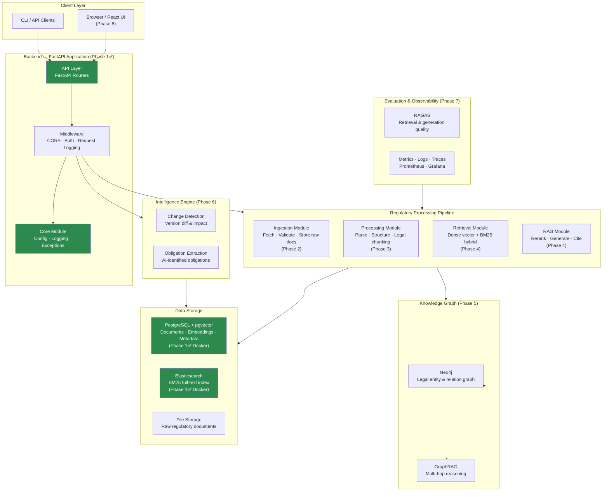

# System Architecture

> RegulaRAG — AI-Powered Regulatory Intelligence & Compliance Analysis Platform

---

## Overview

RegulaRAG is designed as a **modular monolith** — a single deployable Python application with clearly separated internal modules. This architecture provides simplicity and testability during early development phases while enabling module extraction into independent services if scale demands it in the future.

The system follows a **layered architecture** pattern: API → Pipeline → Storage, with a separate Intelligence Engine for higher-level regulatory analysis.

---

## Architecture Diagram



---

## Backend Modularity

The backend is organised as the `regularag` Python package under `src/regularag/`. Each subdirectory corresponds to a functional domain:

| Module | Domain | Phase |
|--------|---------|-------|
| `core/` | Configuration, logging, exceptions | ✅ 1 |
| `api/` | FastAPI routers and schemas | ✅ 1 |
| `ingestion/` | Document fetching and validation | 2 |
| `processing/` | Parsing, chunking, structuring | 3 |
| `retrieval/` | Vector and lexical retrieval | 4 |
| `rag/` | Reranking and answer generation | 4 |
| `graph/` | Knowledge graph operations | 5 |
| `intelligence/` | Change detection, obligation extraction | 6 |
| `evaluation/` | RAGAS evaluation and benchmarking | 7 |

---

## Data Flow

### Document Ingestion (Phase 2–3)

```
Official Source URL
    → Ingestion Module (download, validate, store raw)
    → Processing Module (parse structure, legal chunking)
    → PostgreSQL (metadata, chunk text)
    → pgvector (chunk embeddings)
    → Elasticsearch (BM25 index)
    → Neo4j (legal entity graph)
```

### RAG Query (Phase 4)

```
User Question
    → API Layer (validate, authenticate)
    → RAG Module (query decomposition)
    → Retrieval Module (dense + BM25 hybrid search)
    → Cross-encoder Reranker (relevance scoring)
    → LLM (citation-grounded answer generation)
    → API Response (answer + source citations)
```

---

## Database Responsibilities

| Database | Role | Phase |
|----------|------|-------|
| **PostgreSQL** | Documents, chunks, metadata, users, audit logs | Phase 3+ |
| **pgvector** | Dense embedding vectors (stored in PostgreSQL) | Phase 3+ |
| **Elasticsearch** | BM25 full-text search, keyword retrieval | Phase 4+ |
| **Neo4j** | Legal entity graph, cross-regulation relations | Phase 5+ |

---

## External Service Integrations

| Service | Purpose | Phase |
|---------|---------|-------|
| OpenAI / Anthropic | Answer generation, embedding | Phase 4+ |
| Official EUR-Lex API | Regulatory document source | Phase 2+ |
| Sentence Transformers | Local embedding generation | Phase 3+ |

---

## RAG Processing Flow

The full RAG pipeline (planned for Phase 4) will follow this pattern:

1. **Query Analysis** — Decompose complex regulatory questions into sub-queries.
2. **Hybrid Retrieval** — Combine dense vector similarity (pgvector) with BM25 keyword matching (Elasticsearch).
3. **Cross-encoder Reranking** — Rescore retrieved chunks for relevance using a cross-encoder model.
4. **Context Assembly** — Assemble the ranked chunks into a structured prompt with citation metadata.
5. **Answer Generation** — Call the LLM to produce a grounded answer citing specific articles.
6. **Response Validation** — Verify that all citations are traceable to ingested documents.

---

## Evaluation and Monitoring (Phase 7)

| Component | Tool | Purpose |
|-----------|------|---------|
| RAG quality | RAGAS | Faithfulness, answer relevancy, context recall |
| API metrics | Prometheus + Grafana | Latency, throughput, error rates |
| Distributed traces | OpenTelemetry | End-to-end request tracing |
| Log aggregation | Structured JSON logs | Centralised log analysis |

---

## Security Design

- All secrets loaded from environment variables, never hardcoded.
- Non-root container user in Docker runtime image.
- CORS middleware restricting allowed origins.
- Planned: JWT authentication, API rate limiting, audit logging.

---

## Planned vs Implemented

| Component | Implemented | Phase |
|-----------|-------------|-------|
| Project structure | ✅ | 1 |
| FastAPI application | ✅ | 1 |
| Configuration management | ✅ | 1 |
| Structured logging | ✅ | 1 |
| Exception handling | ✅ | 1 |
| Docker environment | ✅ | 1 |
| Document ingestion pipeline | ❌ | 2 |
| Legal document parsing | ❌ | 3 |
| Vector embeddings | ❌ | 3 |
| Hybrid RAG engine | ❌ | 4 |
| Legal Knowledge Graph | ❌ | 5 |
| Change detection | ❌ | 6 |
| Evaluation framework | ❌ | 7 |
| React frontend | ❌ | 8 |

