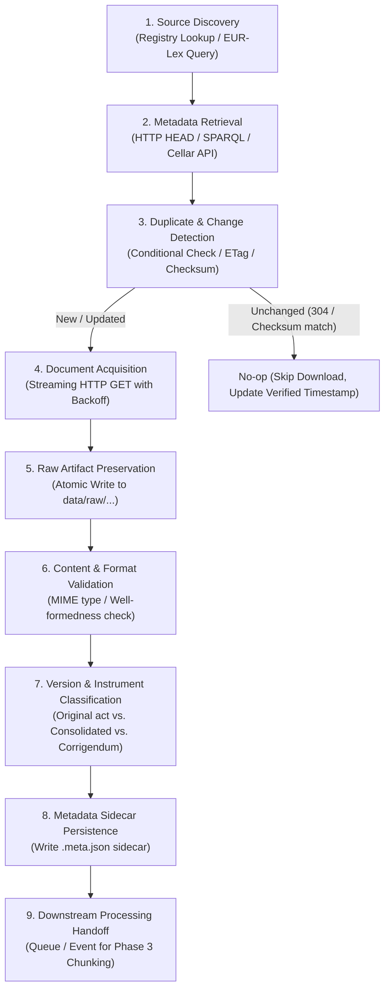

# Regulatory Data Ingestion Pipeline Design

> **RegulaRAG — AI-Powered Regulatory Intelligence & Compliance Analysis Platform**  
> **Subphase:** Phase 2, Subphase 2.1  
> **Design Status:** Approved Architectural Specification  
> **Authoritative Source:** EUR-Lex (Publications Office of the European Union)

---

## 1. Executive Summary & Design Principles

The RegulaRAG ingestion pipeline is responsible for acquiring authoritative legal documents, validating their cryptographic and structural integrity, and storing immutable raw artifacts alongside structured metadata.

### Core Architectural Principles
1. **Source Authenticity:** All regulatory texts must originate directly from official institutional repositories (primarily EUR-Lex). Unofficial secondary sites are prohibited.
2. **Immutability of Raw Artifacts:** The original downloaded document (HTML, XML, or PDF) is stored unchanged. Downstream parsing, chunking, or cleaning must never mutate the raw artifact.
3. **Deterministic Storage:** Every stored file follows a predictable, reproducible directory and naming convention.
4. **Cryptographic Traceability:** Every artifact is fingerprinted with a SHA-256 checksum upon acquisition to guarantee provenance and detect tampering.
5. **Strict Version & Category Segregation:** Original legal acts, consolidated syntheses, corrigenda, and amending acts must be cleanly categorized and never conflated.

---

## 2. Regulatory Document Ingestion Lifecycle

The ingestion workflow proceeds through nine discrete, deterministic stages:



### Detailed Lifecycle Stages

1. **Source Discovery:**
   - Evaluates target document requests against `configs/regulatory_sources.yaml`.
   - Resolves target CELEX identifier, official EUR-Lex URL, and preferred format.
2. **Metadata Retrieval:**
   - Performs conditional metadata queries (HTTP `HEAD` request or EUR-Lex Cellar/SPARQL metadata lookup).
   - Collects `Content-Length`, `Content-Type`, `ETag`, and `Last-Modified` headers.
3. **Duplicate & Change Detection:**
   - Checks local storage for matching `(document_id, version, format)` tuples.
   - Evaluates conditional headers (`If-None-Match`, `If-Modified-Since`).
   - If unchanged, marks the registry verified timestamp and skips redundant download.
4. **Document Acquisition:**
   - Executes streaming HTTP GET using an asynchronous client with rate-limiting and connection pooling.
   - Applies exponential backoff with jitter on transient network/server errors (500, 502, 503, 504, 429).
5. **Raw Artifact Preservation:**
   - Downloads into a temporary file (`.part`), computes the SHA-256 hash incrementally, and renames atomically to the target filename upon completion.
6. **Content & Format Validation:**
   - Verifies the downloaded file exceeds minimum size thresholds (>1 KB).
   - Validates format headers (e.g., HTML contains `<!DOCTYPE html>` or `<html>`, XML is well-formed, PDF starts with `%PDF-`).
7. **Version & Instrument Classification:**
   - Identifies whether the artifact represents a base act (Sector 3), an official corrigendum (`R(xx)`), or an editorial consolidation (Sector 0).
8. **Metadata Sidecar Persistence:**
   - Emits an immutable JSON sidecar (`.meta.json`) adjacent to the downloaded artifact.
9. **Downstream Processing Handoff:**
   - Signals availability of the validated artifact for structural parsing and legal-aware semantic chunking (Phase 3).

---

## 3. Ingestion Metadata Contract

Every acquired document artifact produces an immutable metadata sidecar conforming to the schema below:

```json
{
  "$schema": "https://regularag.org/schemas/v1/artifact_metadata.json",
  "artifact_id": "art_32024R1689_oj_en_html_v20240712",
  "artifact_version_id": "orig_32024R1689_2024-07-12",
  "document_id": "eu_ai_act",
  "name": "Regulation (EU) 2024/1689 of the European Parliament and of the Council of 13 June 2024 laying down harmonised rules on artificial intelligence...",
  "abbreviation": "EU AI Act",
  "instrument_type": "Regulation",
  "celex_id": "32024R1689",
  "eli_uri": "http://data.europa.eu/eli/reg/2024/1689/oj",
  "jurisdiction": "EU",
  "source_authority": "European Parliament and Council of the European Union",
  "source_url": "https://eur-lex.europa.eu/legal-content/EN/TXT/?uri=CELEX:32024R1689",
  "language": "EN",
  "document_category": "original_act",
  "is_consolidated": false,
  "consolidation_date": null,
  "is_corrigendum": false,
  "corrigendum_parent_celex": null,
  "publication_date": "2024-07-12",
  "entry_into_force_date": "2024-08-01",
  "application_date": "2026-08-02",
  "transposition_deadline": null,
  "acquisition": {
    "retrieved_at": "2026-11-02T20:15:30.123456Z",
    "http_status": 200,
    "etag": "\"12345-abcdef67890\"",
    "last_modified_header": "Fri, 12 Jul 2024 07:00:00 GMT",
    "retrieval_duration_seconds": 1.42
  },
  "file_metadata": {
    "format": "HTML",
    "media_type": "text/html",
    "file_size_bytes": 1845230,
    "sha256_checksum": "9f86d081884c7d659a2feaa0c55ad015a3bf4f1b2b0b822cd15d6c15b0f00a08",
    "storage_relpath": "data/raw/eu/eu_ai_act/original_2024-07-12/eu_ai_act_32024R1689_original.html",
    "sidecar_relpath": "data/raw/eu/eu_ai_act/original_2024-07-12/eu_ai_act_32024R1689_original.meta.json"
  },
  "validation": {
    "is_valid": true,
    "validated_at": "2026-11-02T20:15:31.000000Z",
    "validation_checks_passed": [
      "size_greater_than_1kb",
      "html_well_formed_root",
      "sha256_verified"
    ]
  }
}
```

---

## 4. Distinguishing Document Categories and Version Identity

In regulatory compliance, misidentifying document status creates severe legal risks. The pipeline enforces unambiguous classification rules and distinct, non-overlapping version identifiers.

### Document Category Classification

| Category | CELEX Pattern | Legally Binding? | Update Trigger / Description |
|---|---|---|---|
| **Original Legal Act** | `3YYYY[R/L/D]NNNN` | **Yes (Authentic)** | Published in the Official Journal (OJ). The baseline authentic legal act. |
| **Consolidated Text** | `0YYYY[R/L/D]NNNN-YYYYMMDD` | **No (Editorial synthesis)** | Published periodically by the Publications Office when amendments or corrigenda take effect. Suffix denotes the effective date. |
| **Amending Legal Act** | Distinct CELEX (e.g., `32024R...`) | **Yes (Authentic)** | A separate regulation or directive enacted by legislators to formally modify specific articles of an existing act. |
| **Corrigendum (Correction)** | `3YYYY[R/L/D]NNNNR(XX)` | **Yes (Authentic)** | An official correction rectifying linguistic or typographical errors across OJ editions. |
| **Unchanged Retrieval** | Identical SHA-256 | N/A | Document was queried again, but remote ETag or SHA-256 matches existing local artifact. Zero processing needed. |

### Canonical Immutable Version Identifiers (`artifact_version_id`)

Every acquired artifact possesses an unambiguous, deterministic version identifier derived purely from its legal identity:

1. **Original Legal Acts**:
   - Format: `orig_{celex_id}_{publication_date}`
   - Example: `orig_32024R1689_2024-07-12` (EU AI Act), `orig_32016R0679_2016-05-04` (GDPR)
   - Scope: Fixed to the authentic publication date in the Official Journal.

2. **Consolidated Texts**:
   - Format: `cons_{consolidated_celex_id}`
   - Example: `cons_02016R0679-20210304` (GDPR consolidated to 4 March 2021)
   - Scope: The consolidation date (`20210304`) is an intrinsic component of the CELEX identifier assigned by EUR-Lex, ensuring uniqueness across successive consolidations.

3. **Corrigenda**:
   - Format: `corr_{normalized_celex}_{publication_date}`
   - Example: `corr_32024R1689R01_2024-11-20` (AI Act Corrigendum 1)
   - Scope: Parentheses in `R(01)` are normalized to `R01` for filesystem portability across all operating systems.

### Relationship Between Legal Version Identity and Download Timestamps

A strict conceptual distinction is maintained between **legal version identity** and **operational acquisition timestamps**:

- **Legal Version Identity (`artifact_version_id`)**:
  - Derived entirely from authoritative EU legal metadata (CELEX identifier, category, and publication/consolidation date).
  - **Timeless and immutable**: The authentic text of Regulation (EU) 2016/679 as published on 2016-05-04 remains identical regardless of when it is crawled.
  - Dictates file naming and directory structure under `data/raw/`.
- **Download Timestamp (`retrieved_at`)**:
  - Purely an **operational audit metric** recorded in the metadata sidecar (`document.meta.json` under `acquisition.retrieved_at`).
  - **Never used as a directory key or version discriminator**: Using timestamps in paths would cause redundant duplicate directories on every re-crawl and confound legal revision with network transmission.
- **Idempotent Re-crawling**:
  - When an existing legal version is re-crawled, its streaming SHA-256 is computed.
  - If the SHA-256 matches the existing artifact, the raw file is **not overwritten**. The system logs an idempotent retrieval event without disturbing downstream pipelines.
  - Distinct legal artifacts (original act, corrigenda, consolidations) live in isolated subdirectories and **can never overwrite each other**.

---

## 5. Raw Data Storage Architecture

### Directory Layout

Storage is structured deterministically by jurisdiction, document identifier, and legal artifact namespace:

```
data/raw/
└── {jurisdiction}/
    └── {document_id}/
        ├── original_{publication_date}/
        │   ├── {document_id}_{celex}_original.html
        │   ├── {document_id}_{celex}_original.meta.json
        │   └── {document_id}_{celex}_original.pdf (optional secondary format)
        ├── corrigenda/
        │   └── {normalized_corrigendum_celex}/
        │       ├── {document_id}_{normalized_corrigendum_celex}.html
        │       └── {document_id}_{normalized_corrigendum_celex}.meta.json
        └── consolidated_{consolidation_date}/
            ├── {document_id}_{consolidated_celex}.html
            └── {document_id}_{consolidated_celex}.meta.json
```

### Example Structure for GDPR:
```
data/raw/
└── eu/
    └── eu_gdpr/
        ├── original_2016-05-04/
        │   ├── eu_gdpr_32016R0679_original.html
        │   └── eu_gdpr_32016R0679_original.meta.json
        ├── corrigenda/
        │   ├── 32016R0679R02/
        │   │   ├── eu_gdpr_32016R0679R02.html
        │   │   └── eu_gdpr_32016R0679R02.meta.json
        │   └── 32016R0679R03/
        │       ├── eu_gdpr_32016R0679R03.html
        │       └── eu_gdpr_32016R0679R03.meta.json
        └── consolidated_2021-03-04/
            ├── eu_gdpr_02016R0679-20210304.html
            └── eu_gdpr_02016R0679-20210304.meta.json
```

### Safety and Atomicity Rules
- **Atomic Writes:** Downloads stream to a staging file `filename.tmp.[uuid]` and are renamed into permanent storage only after the download completes and the computed SHA-256 matches validation checks.
- **Fail-Safe Cleanup:** If a download stream fails or is cancelled, the `.tmp` file is immediately deleted.
- **Read-Only Downstream Operations:** Processing and embedding components mount `data/raw` strictly read-only.
- **Isolated Namespaces:** `original_*`, `corrigenda/*`, and `consolidated_*` are non-overlapping paths.

---

## 6. Update Detection Strategy

To prevent redundant downloads while guaranteeing absolute legal accuracy, the pipeline establishes a clear distinction between **transport-level optimization hints** and **authoritative legal-version evidence**:

```
┌─────────────────────────────────────────────────────────────┐
│ 1. HTTP HEAD with Conditional Headers (Transport Hint)      │
│    (If-None-Match: etag, If-Modified-Since: date)           │
│    Optimization: 304 Not Modified skips byte transfer       │
├─────────────────────────────────────────────────────────────┤
│ 2. EUR-Lex Cellar SPARQL Metadata Query (Legal Authority)   │
│    Authoritative: Discovers newly published corrigenda,     │
│    amendments, or consolidated editions in the OJ           │
├─────────────────────────────────────────────────────────────┤
│ 3. Streaming SHA-256 Digest Verification (Content Authority)│
│    Authoritative: Byte-level cryptographic proof of payload  │
│    identity; prevents corrupt or duplicate storage          │
└─────────────────────────────────────────────────────────────┘
```

### Transport Optimization Hints vs. Authoritative Evidence

| Mechanism | Layer | Authority Level | Role & Behavior |
|---|---|---|---|
| **ETag Header** | HTTP Transport | **Optimization Hint (Non-authoritative)** | Web server cache validator. Can change due to EUR-Lex web server redeployments, reverse proxy restarts, or HTTP compression variations without any legal text change. Used to skip transfer via HTTP 304, but a changed ETag does *not* prove legal amendment. |
| **Last-Modified Header** | HTTP Transport | **Optimization Hint (Non-authoritative)** | Filesystem timestamp from the EUR-Lex origin server. May change during backend CMS maintenance or website re-indexing. |
| **Conditional GET (`If-None-Match`, `If-Modified-Since`)** | HTTP Transport | **Optimization Hint** | Purely bandwidth/network optimization. Enables fast `304 Not Modified` short-circuiting. |
| **EUR-Lex Cellar / SPARQL Metadata** | EU Legal System of Record | **Authoritative Legal Evidence** | Authoritative notice that a new corrigendum, amending act, or consolidated family has been officially published in the Official Journal. Drives the generation of new registry entries and acquisition targets. |
| **Cryptographic SHA-256 Digest** | Content / Cryptographic | **Authoritative Content Evidence** | Calculated on the streaming payload before permanent commit. Authoritative proof of byte-for-byte content identity. If the SHA-256 matches an existing local artifact, the local file is preserved untouched. |

---

## 7. Reliability, Rate Limiting, and Error Handling

### HTTP Client Policies
- **User Agent:** `RegulaRAG-Bot/0.1.0 (+https://github.com/Rabyegh/RegulaRAG; compliance-research)`
- **Polite Crawling Rate:** Maximum 1 request per second to EUR-Lex endpoints.
- **Connection Timeout:** 10 seconds.
- **Read Timeout:** 60 seconds (accommodates large regulatory documents up to 5 MB).
- **Concurrency:** Maximum 2 concurrent connections per domain.

### Fault Matrix and Mitigation

| Error Scenario | HTTP Status | Handling Strategy |
|---|---|---|
| Rate limited | 429 Too Many Requests | Obey `Retry-After` header if present; otherwise apply exponential backoff (initial delay: 5s, multiplier: 2.0, max: 60s). |
| Server unavailable | 502 / 503 / 504 | Up to 3 retries with jittered exponential backoff. |
| Document not found | 404 Not Found | Mark source entry as `failed_discovery`; do not retry automatically; log warning with CELEX and URL for review. |
| Incomplete stream | Network disconnect | Discard `.tmp` file; increment retry counter; log socket error. |
| Malformed content | Content validation failure | Flag artifact as `corrupted`; quarantine file to `data/quarantine/`; notify pipeline monitor. |

---

## 8. Document Acquisition Layer Implementation (Subphase 2.2)

### Connector Architecture Overview

The acquisition layer implemented in Subphase 2.2 translates the conceptual ingestion lifecycle into concrete, asynchronous Python components located under `src/regularag/ingestion/`:

```
src/regularag/ingestion/
├── connectors/
│   ├── __init__.py                # Package exports
│   ├── base.py                    # BaseAcquisitionConnector ABC
│   └── eurlex.py                  # EurLexHttpConnector implementation
├── models.py                      # Data contracts, sidecar schemas, audit models
├── service.py                     # AcquisitionService high-level orchestrator
├── sources.py                     # RegulatorySourceRegistry YAML loader
└── storage.py                     # RawArtifactStorage filesystem manager
```

### Key Components

1. **`BaseAcquisitionConnector` (`connectors/base.py`)**:
   - Abstract base class declaring the standard acquisition contract: `acquire(source, target_format)` and `close()`.
   - Supports asynchronous context management via `async with connector:`.

2. **`EurLexHttpConnector` (`connectors/eurlex.py`)**:
   - Asynchronous HTTP acquisition connector using `httpx.AsyncClient`.
   - **Streaming Downloads:** Streams response bodies in 64 KB chunks via `aiter_bytes()`.
   - **Rate Limiting:** Paces outbound requests via `asyncio.Lock` and monotonic timestamps according to `ingestion_request_rate_limit`.
   - **Conditional Requests:** Re-uses previously recorded `ETag` (`If-None-Match`) and `Last-Modified` (`If-Modified-Since`) headers.
   - **Fault Tolerance:** Retries transient 429, 500, 502, 503, 504 errors and timeouts with exponential backoff and `Retry-After` header adherence. Non-transient errors (404) fail immediately.
   - **Content Validation:** Validates response size (> 100 bytes), Content-Type headers, HTML/XML plausibility markers, and detects HTTP 200 error pages.

3. **`RawArtifactStorage` (`storage.py`)**:
   - Implements deterministic directory layout under `data/raw/{jurisdiction}/{document_id}/...`.
   - Generates staging files `.tmp.{uuid}` during download to prevent partial-file reads.
   - **Atomic Commit:** Renames staging files into permanent paths atomically.
   - **Integrity Validation:** Compares new SHA-256 against existing artifacts, raising `VersionIntegrityConflictError` if an immutable legal version has conflicting content.
   - **Sidecar Writer:** Generates validated `ArtifactSidecarMetadata` and writes adjacent `.meta.json` sidecars atomically.

4. **`AcquisitionService` (`service.py`)**:
   - High-level orchestrator dispatching acquisitions by `document_id` or `celex_id`.
   - Supports batch acquisition across all sources registered in `configs/regulatory_sources.yaml`.

### Testing Without Live Network

All acquisition unit tests in `tests/unit/test_acquisition.py` use mocked HTTP transports (`httpx.MockTransport`) and temporary directory isolation:
- No live network requests are made during standard test execution.
- Deterministic byte streaming, timeout simulation, retry counts, backoff triggers, and SHA-256 calculations are fully verified offline.
- Total coverage reaches > 90% across all ingestion modules.


